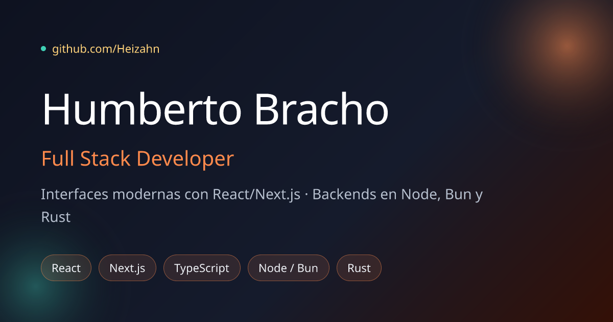

<div align="center">

# Humberto Bracho — Portfolio

**Desarrollador Full Stack · React, Node/Bun, Rust**

[**Ver sitio →**](https://heizahn-portfolio.humbertorbw.workers.dev)

[](https://github.com/Heizahn/web-portfolio/actions/workflows/deploy.yml)




</div>

---

## Qué es

Mi portafolio personal: un sitio estático, bilingüe (ES/EN) y con modo claro/oscuro, construido sobre **Forja**, un sistema de diseño propio con tokens, movimiento e ilustraciones hechas para el sitio.

- **Bilingüe**: detecta el idioma del navegador y permite cambiarlo en vivo.
- **Tema claro/oscuro** con `next-themes`, sin parpadeo al cargar.
- **Sección GitHub en vivo**: perfil, estadísticas, lenguajes, repos y mapa de contribuciones, obtenidos de la API de GitHub en cada build.
- **Forja Design System**, documentado en [`/design-system`](https://heizahn-portfolio.humbertorbw.workers.dev/design-system).
- **Accesible**: respeta `prefers-reduced-motion`; las animaciones de ambiente se apagan solas.
- **SEO completo**: metadata, Open Graph, `sitemap.xml`, `robots.txt` y manifest.
- **Cero servidor**: export estático servido desde el edge de Cloudflare.

## Stack

| Capa        | Tecnología                                                  |
| ----------- | ----------------------------------------------------------- |
| Framework   | Next.js 14 (App Router, `output: 'export'`) · React 18      |
| Lenguaje    | TypeScript 5                                                |
| Estilos     | Tailwind CSS 3 + tokens CSS (`src/app/globals.css`)         |
| Movimiento  | Framer Motion                                               |
| Gráficas    | Recharts · react-github-calendar                            |
| Tipografía  | Bricolage Grotesque · Instrument Sans · JetBrains Mono      |
| Hosting     | Cloudflare Workers (static assets) vía Wrangler             |
| CI/CD       | GitHub Actions                                              |

## Cómo funciona

```
push a main ─┐
cada 6 h ────┼─► GitHub Actions ─► next build ─► ./out ─► wrangler deploy ─► Cloudflare
manual ──────┘                        │
                                      └─ consulta la API de GitHub (perfil, repos, lenguajes)
```

No hay backend: los datos de GitHub se resuelven **en tiempo de build** y quedan horneados en el HTML. El cron cada 6 horas reconstruye el sitio para que esa sección no se quede vieja.

## Desarrollo local

Requiere **Node.js 22** (la misma versión que usa CI).

```bash
git clone git@github.com:Heizahn/web-portfolio.git
cd web-portfolio
npm ci
npm run dev        # http://localhost:3000
```

> [!TIP]
> Sin token, la API de GitHub permite 60 peticiones/hora por IP. Si el build falla en la sección GitHub, crea un `.env.local` con `GITHUB_TOKEN=<token de solo lectura>`.

### Scripts

| Comando           | Qué hace                                                   |
| ----------------- | ---------------------------------------------------------- |
| `npm run dev`     | Servidor de desarrollo con recarga en caliente             |
| `npm run build`   | Genera el sitio estático en `./out`                        |
| `npm run preview` | Build + sirve `./out` localmente con Wrangler              |
| `npm run deploy`  | Build + publica en Cloudflare (requiere `wrangler login`)  |
| `npm run lint`    | ESLint con la config de Next                               |

### Variables de entorno

Todas son opcionales; los valores por defecto están en [`src/env/env.ts`](src/env/env.ts).

| Variable                  | Uso                                                        |
| ------------------------- | ---------------------------------------------------------- |
| `GITHUB_TOKEN`            | Autentica la API de GitHub en el build (sube el límite)    |
| `NEXT_PUBLIC_SITE_URL`    | URL pública: canonical, Open Graph, sitemap y robots       |
| `NEXT_PUBLIC_GITHUB_USER` | Usuario cuyos datos muestra la sección GitHub              |
| `NEXT_PUBLIC_GITHUB`      | Enlace al perfil de GitHub                                 |
| `NEXT_PUBLIC_LINKED_IN`   | Enlace al perfil de LinkedIn                               |
| `NEXT_PUBLIC_MAILTO`      | Enlace `mailto:` de contacto                               |

## Estructura

```
src/
├── app/
│   ├── page.tsx              # Home: ensambla las secciones
│   ├── layout.tsx            # Fuentes, metadata, tema e idioma
│   ├── design-system/        # Página /design-system (showcase de Forja)
│   ├── globals.css           # Tokens de color, sombras y curvas
│   └── sitemap.ts · robots.ts · manifest.ts · not-found.tsx
├── components/
│   ├── ds/                   # Forja: componentes y glifos del sistema de diseño
│   ├── section-1/            # Hero
│   ├── sectionStudy/         # Formación
│   ├── sectionGithub/        # Perfil, stats, lenguajes, repos, contribuciones
│   ├── sectionproyects/      # Proyectos
│   ├── sectionAbout/         # Sobre mí
│   ├── Contact/ · Footer/ · Navbar/
│   ├── context/ · hooks/     # Idioma (LangContext, useLang)
│   └── theme/                # ThemeProvider y ThemeToggle
├── env/env.ts                # Configuración pública
└── lib/github.ts             # Cliente de la API de GitHub
public/
├── illustrations/            # Ilustraciones SVG de Forja
└── imgP1/                    # Imágenes de proyectos
```

## Editar contenido

Todo el texto vive en un `data.json` junto a cada sección, con una clave por idioma:

```jsonc
// src/components/sectionproyects/data.json
{
  "es": { "title": "Proyectos seleccionados", "projects": [ … ] },
  "en": { "title": "Selected projects",       "projects": [ … ] }
}
```

Para cambiar un texto, edítalo en **ambos** idiomas. Las imágenes de proyectos van en `public/imgP1/`.

## Forja · Design System

Sistema de diseño con temática de forja: brasas, chispas y metal templado. Se ve completo en [`/design-system`](https://heizahn-portfolio.humbertorbw.workers.dev/design-system).

- **Tokens** en `globals.css` como canales RGB (`--ember`, `--spark`, `--verdigris`, `--flame`, `--surface`, `--ink`…), redefinidos para modo oscuro y expuestos a Tailwind.
- **Curvas** propias: `--ease-forge`, `--ease-strike`, `--ease-spring`.
- **Componentes** (`src/components/ds`): `EmberField`, `TemperText`, `SparkButton`, `SpotlightCard`, `Reveal`, `TechChip`, `TechMarquee`, `PairTerminal`, `Illustration` y el hook `useReducedMotion`.
- **Ilustraciones**: `forge-terminal`, `pair-cursors`, `stack-orbit`, `commit-graph` y `anvil-404`.

```tsx
import { Reveal, SparkButton } from '@/components/ds';
```

## Despliegue

El sitio se publica en **Cloudflare Workers** como assets estáticos ([`wrangler.jsonc`](wrangler.jsonc)). El workflow [`deploy.yml`](.github/workflows/deploy.yml) despliega solo en cada push a `main`, cada 6 horas o a mano desde la pestaña Actions.

El repositorio necesita dos secrets:

| Secret                  | Valor                                                   |
| ----------------------- | ------------------------------------------------------- |
| `CLOUDFLARE_API_TOKEN`  | Token con la plantilla **Edit Cloudflare Workers**      |
| `CLOUDFLARE_ACCOUNT_ID` | ID de la cuenta de Cloudflare                           |

### Dominio propio

1. Agrega el dominio como zona en Cloudflare.
2. Descomenta el bloque `routes` en `wrangler.jsonc`.
3. Cambia `SITE_URL` en `src/env/env.ts`.
4. Haz push a `main`.

## Contacto

- **GitHub**: [@Heizahn](https://github.com/Heizahn)
- **LinkedIn**: [in/heizahn](https://www.linkedin.com/in/heizahn/)
- **Email**: [hrbweibezahn@gmail.com](mailto:hrbweibezahn@gmail.com)

<div align="center"><sub>Forjado con Next.js y desplegado en Cloudflare.</sub></div>
